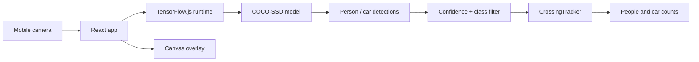

# POCIA Count

POCIA Count is a browser-based prototype for counting **people** and **cars** crossing a virtual line from a mobile camera feed.

The project was built end-to-end using **OpenAI Codex** as the main coding assistant: from the initial React/Vite implementation to the TensorFlow.js integration, crossing-line tracking logic, tests, README and deployment configuration.

[Live demo](https://pocia-count.netlify.app/) · [Repository](https://github.com/JulioAmestica/pocia-count)


## Why I built this

This project started as a practical experiment: can a mobile browser count people or cars using only the device camera in front or back side, without a backend or video-processing server?

The goal was not to build a production traffic analytics system. The goal was to validate a small but complete AI-assisted development workflow:

1. define a real-world computer vision problem;
2. build a functional prototype quickly;
3. use Codex to generate and iterate on the implementation;
4. add tests around the non-visual counting logic;
5. document the architecture, limitations and deployment path.

## What it does

- Opens the device camera with `getUserMedia`.
- Loads the COCO-SSD object detection model in the browser through TensorFlow.js.
- Detects `person` and `car` classes.
- Draws bounding boxes, confidence labels and a counting line on a canvas overlay.
- Counts an object when its tracked center crosses the selected line.
- Supports horizontal and vertical line orientation.
- Allows resetting the counters.
- Runs as a static site deployed on Netlify.

## How I used Codex

I used Codex as the main development partner for the complete project, not only for isolated snippets.

The workflow was:

- **Scoping:** define the smallest useful version of the app: camera, detection, crossing line, counters and deployment.
- **Implementation:** generate the React/Vite structure, TensorFlow.js loading flow, camera handling, canvas overlay and tracker module.
- **Iteration:** adjust the UI for mobile usage, tune the detection confidence threshold and separate visual code from counting logic.
- **Testing:** create unit tests for the `CrossingTracker` behavior and a basic React render test.
- **Documentation:** write a README that explains how the app works, what was verified and what still needs production hardening.

What I intentionally kept under human review:

- the product scope;
- the architecture trade-offs;
- privacy implications of camera access;
- test coverage for counting behavior;
- limitations and production-readiness notes.

## Tech stack

| Area                    | Tools                          |
| ----------------------- | ------------------------------ |
| Frontend                | React 19, TypeScript, Vite     |
| Computer vision         | TensorFlow.js, COCO-SSD        |
| Testing                 | Vitest, Testing Library, jsdom |
| Deployment              | Netlify                        |
| AI-assisted development | OpenAI Codex                   |

## Architecture



The model runs locally in the browser. Each frame is analyzed on the client, filtered by confidence score and object class, then passed to a small tracking module that checks whether the object crossed the selected line.

No video frames are uploaded to a backend service.

## How counting works

1. The user select and starts the camera.
2. TensorFlow.js loads the COCO-SSD model.
3. The app reads predictions from each video frame.
4. Predictions are filtered to keep only `person` and `car` above the confidence threshold.
5. The center point of each bounding box is tracked across frames.
6. If a tracked object changes side across the selected line, the corresponding counter is incremented.

Current confidence threshold:

```ts
const confidenceThreshold = 0.55;
```

The tracking logic lives in [`src/tracker.ts`](src/tracker.ts), separate from the React camera and rendering code.

## Project structure

```text
src/
  App.tsx          # Camera access, model loading, detection loop and UI
  tracker.ts      # Crossing-line tracking and counting logic
  tracker.test.ts # Unit tests for counting behavior
  App.test.tsx    # Basic React render test
  main.css        # Responsive UI styles
netlify.toml      # Static deployment config and camera permissions policy
```

## Getting started

### Prerequisites

- Node.js 20+
- npm
- A browser with camera support

### Run locally

```bash
git clone https://github.com/JulioAmestica/pocia-count.git
cd pocia-count
npm install
npm run dev
```

Open the local URL printed by Vite, usually:

```text
http://localhost:5173/
```

Camera access usually requires `localhost` or HTTPS, depending on the browser.

### Run tests

```bash
npm test
```

### Build

```bash
npm run build
```

### Preview production build

```bash
npm run preview
```

## Verification

The project includes tests for:

- crossing detection for tracked objects;
- counter reset behavior;
- initial React rendering.

Manual verification should include:

- opening the app on a mobile browser;
- granting camera permissions;
- testing both horizontal and vertical line modes;
- moving a person or object-like target across the line;
- checking that counters reset correctly.

## Privacy

The camera stream is processed locally in the browser. This prototype does not upload video frames to a backend server.

The Netlify configuration includes a camera permissions policy:

```toml
Permissions-Policy = "camera=(self)"
```

## Accuracy notes

Accuracy depends on real-world conditions:

- camera angle and height;
- lighting conditions;
- object distance from the camera;
- occlusion between people or vehicles;
- device performance;
- crowd or traffic density;
- COCO-SSD confidence score;
- browser and mobile hardware limitations.

For production use, the system would need field calibration, benchmark data, error tracking and a more robust multi-object tracking strategy.

## Known limitations

- Prototype only; not calibrated for production counting.
- Supports `person` and `car` classes only.
- The counting line is centered and can be horizontal or vertical.
- No backend, persistence, dashboard or historical reporting.
- Detection performance depends on the user's device.
- Browser camera permissions are required.
- The simple tracker can miscount in crowded scenes, heavy occlusion or fast motion.

## Possible next steps

- Add a configurable confidence threshold in the UI.
- Allow dragging the counting line instead of keeping it centered.
- Add local session history or exportable results.
- Improve tracking with stronger object identity handling.
- Add benchmark videos for repeatable accuracy testing.
- Document a full Codex workflow from issue to implementation to test.

## Status

Proof of concept. Core browser-based detection, crossing logic, tests and static deployment are implemented.

## License

No license has been specified yet.
